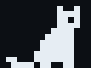

# chrome-cat

<p align="center"></p>

Chat with any page. Locally. The cat helps.

A Chrome side panel that scans the page you're on into letter-size image
tiles, OCRs them with [Tesseract.js](https://github.com/naptha/tesseract.js)
(vendored, offline), and puts Chrome's built-in model
([Gemini Nano](https://developer.chrome.com/docs/ai/prompt-api)) in front of
the result. No server. No API key. Nothing leaves the machine.


## Install

**From a release** (fastest):

1. Download the latest zip from [Releases](https://github.com/mbarlow/chrome-cat/releases) and unzip it
2. `chrome://extensions` → Developer mode → **Load unpacked** → the unzipped folder

**From source:**

```
git clone git@github.com:mbarlow/chrome-cat && cd chrome-cat
make vendor icons
```

Then load unpacked from the repo root.

Google Chrome 138+ desktop. Gemini Nano downloads on first use — hit
**download** in the panel header (`chrome://on-device-internals` if it stalls).
Distro Chromium builds (e.g. Arch) ship a placeholder model that only echoes
the prompt; the header flags it.

## Use it

Hit **Scan page**, then talk:

| Say | Get |
|---|---|
| `what is this about?` | grounded answers from the scanned content |
| `what links are there?` | the page's real URLs, never invented |
| `open the pricing page` | navigates, scans, chat follows |
| `/follow` | crawls the page's links into a series — step it with ◀ ▶ |
| `email the summary` | Gmail compose, prefilled |
| `calendar event for this` | Calendar draft, prefilled |
| `save as pdf` | the scan tiles as a letter-size PDF, one page per tile |
| `email the pdf version` | saves the PDF + opens the draft — one drag attaches |
| `copy that` / `save the chat as markdown` | clipboard / `Downloads/chrome-cat/` |
| `send the summary to vault` | POST to a named webhook (settings) |
| `make a table of the prices` | a table from page text — ⤓ csv, ⤓ json, ⧉ copy |
| `/bookmark` | files the page into your bookmark folders, model-picked |
| `any images on the page?` | the model looks at the actual scan tiles |
| `read it to me` | speaks the answer |

**Memory tab** — chat with everything you've captured, today's history, the
last 7 days, or your bookmarks. Click any item to jump to it with the chat
scoped; pages you've scanned answer with real content.

**Omnibox** — type `cc <query>` in the address bar to search your whole
capture memory and jump straight to a page + its chat.

**Artifacts tab** — every scan's tiles, OCR text, and DOM text: view, copy,
export, re-summarize. The ⤓ button saves any chat as clean markdown.

**Sources** — answers grounded in the page carry ↗ chips under them; click
one to jump to the passage on the live page, highlighted.

**⌗ region** — drag a box on the page (or click an image) and ask about just
that, at full resolution. Labelled images inside it bring their alt text.
Every question uses the region until you hit ✕.

**How it answers** — the model routes each question to page text, a look
at the scan tiles, the page's links, a table, or general knowledge (keyword rules if
it can't). Image questions also get the page's alt text and captions.
"Who painted this" is asked twice independently; agreement is stated,
disagreement is hedged (hover the answer to see both guesses). When the
page doesn't cover a question, a labelled general-knowledge answer follows.

The pixel cat in the header shows what's happening — idle, scanning,
replying, working. It lives in `src/mascot/mascot.json`; edit the frames,
get a new cat.

## Webhook receiver in 60 seconds

```
bun run examples/vault-receiver.ts
```

Add `vault → http://localhost:8787/inbox` under settings → webhooks, then
`send the summary to vault`. Every send lands as a markdown file — point
`INBOX_DIR` at your Obsidian inbox and the browser feeds your notes.

## Notes

- Vanilla ES modules, no build step. `make help` for tasks, `make smoke`
  for the headless test, `make e2e` for the real thing: Google Chrome plus
  its Gemini Nano install (copied into a throwaway profile) scans
  `tools/e2e/` and chats through the panel. Failures are tagged TOOLING or
  MODEL; `E2E_RETRIES` (default 1) bounds model retries.
- Everything lives in local IndexedDB — settings shows usage and clears it.
- No network at runtime. `make vendor` is the only thing that touches a CDN,
  at build time, pinned.
- Pinned isn't trusted. Every vendored byte is checksummed in
  `vendor/tesseract/SHA256SUMS`; `make vendor`, `make smoke` and
  `make package` all verify before they proceed. If upstream changes under
  a pinned version, the build stops instead of shipping it.

## License

chrome-cat is [MIT](LICENSE).

`vendor/` is not. It ships Tesseract.js, its WebAssembly core, and Google's
`eng` trained model — all Apache-2.0, redistributed unmodified. The full
attribution list, the Apache text, and the upstream license banners live in
[`vendor/tesseract/NOTICE`](vendor/tesseract/NOTICE). Ship the zip, ship
those files with it — `make package` already does.
