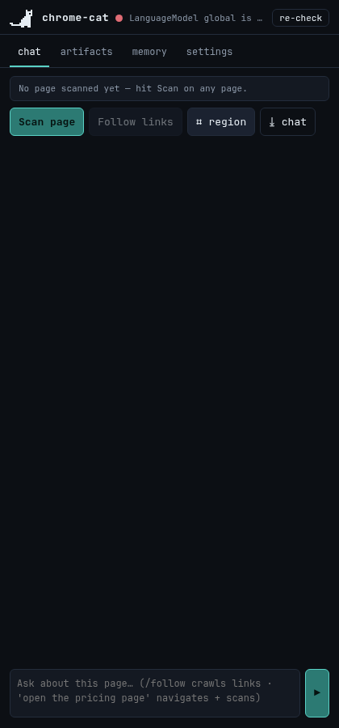
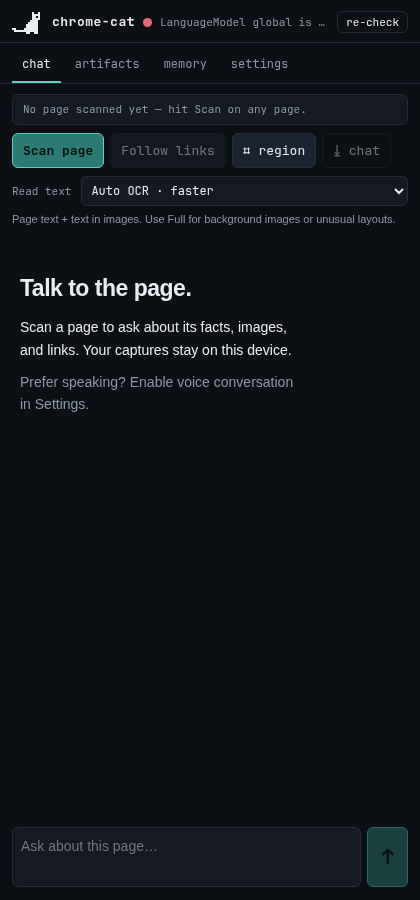
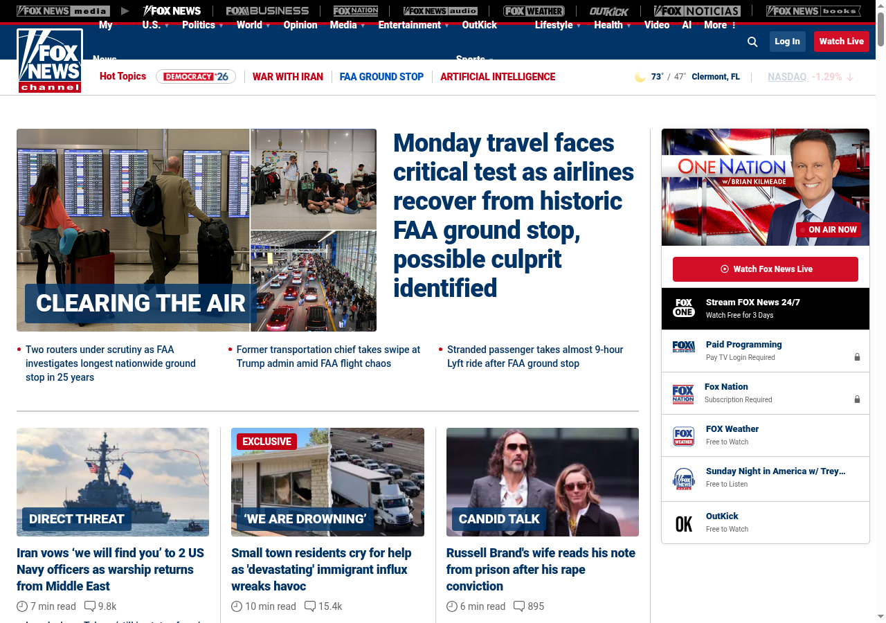
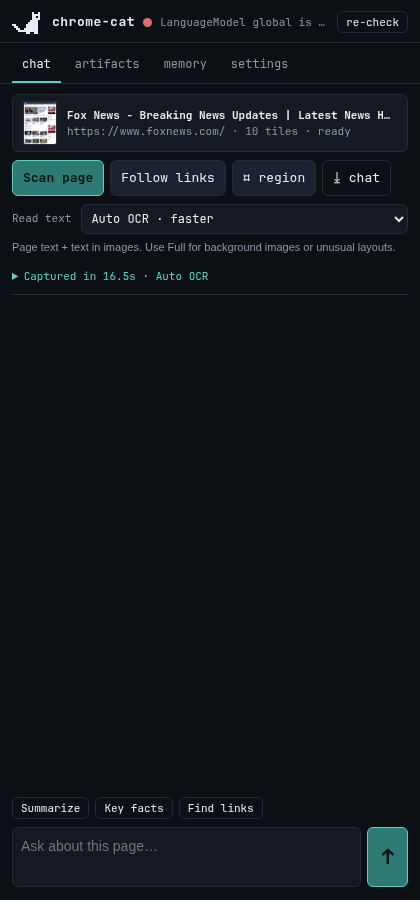
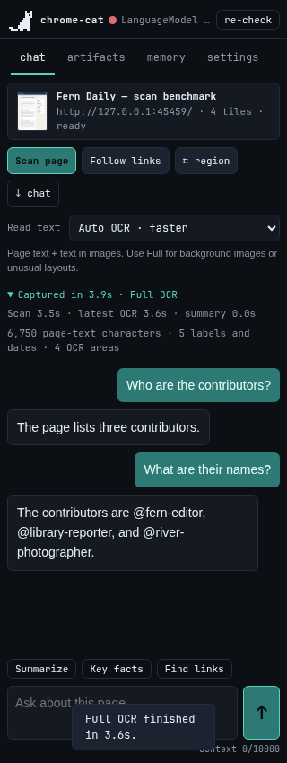
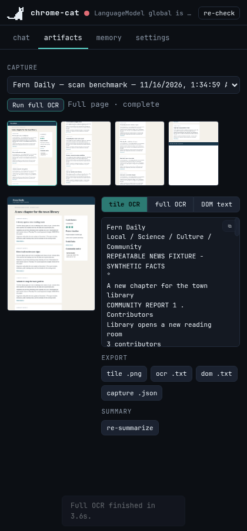

# Chrome Cat scan and conversation review

Version 0.7.0, on `feat/voice-chat`. Reviewed with Playwright on November 16, 2026.

Auto OCR reduced the measured Fox News scan from **32.6 to 16.5 seconds**
(49%). On the repeatable news fixture, the median fell from **8.0 to 3.7
seconds** (54%). This improvement comes primarily from reading DOM text
directly and limiting OCR to image areas. Full-page OCR remains available.

## Measurements

| Page and mode | Baseline | Updated | Samples |
|---|---:|---:|---|
| News fixture → Auto OCR | 8.03 s | 3.72 s | 3 per version, median |
| News fixture → Full OCR | 8.03 s | 8.81 s | 3 per version, median |
| Fox News homepage → Auto OCR | 32.61 s | 16.46 s | 1 per version |

The fixture contains twelve news cards, a canvas notice with the unique text
“MAPLE 728,” small contributor avatars, and separately labelled creation and
update dates. All fixture scans retained the canvas text. Both versions saved
four image tiles. Fox News saved ten tiles in both versions and approximately
23,100 DOM characters. The homepage changed slightly between live runs.

Fox News's capture phase fell from approximately **12.6 to 9.7 seconds**;
OCR fell from approximately **19.3 to 6.1 seconds**. Baseline phase estimates
come from progress-event timestamps; the updated pipeline stores explicit
per-stage timings. The final Auto run processed 209 visual regions in nine
OCR jobs. Stored screenshot tiles remain available for vision and export.

Full OCR's recognition stage remained roughly 3.5–3.9 seconds on the fixture.
Its overall runs ranged from 8.2–11.8 seconds because stitching/PNG encoding
varied. **A full-OCR speed improvement was not established.** Auto OCR is the
faster default, with a different coverage policy described below.

[Machine-readable measurements](measurements.json) include individual runs,
phase endpoints, text counts, tile counts, and the intermediate Fox News runs.

## Review rounds and corrections

1. **Baseline:** every tile received OCR even when the DOM already provided
   its text. Retrieval then preferred DOM chunks and discarded OCR-only facts.
   Small avatar labels were lost, and missing page facts triggered a second
   model call without conversation context.
2. **First optimization:** Auto OCR targeted visual areas; capture calls were
   paced separately from scroll settling. Fox News improved to 25.3 seconds,
   but profiling revealed 202 separate OCR jobs repeatedly decoding tiles.
3. **Batching and interaction review:** image areas are now masked into one
   image per tile, preserving their positions. The intermediate Fox run took
   18.0 seconds. Added scan details, OCR choices, cancellation, starting prompts,
   accessible input labels, and full OCR on saved scans. Playwright exposed
   a send-button race, which was corrected by locking before asynchronous work.
4. **Accuracy and release review:** a canvas-only test exposed incorrect
   recognition with Tesseract's rectangle option, despite correct captured
   pixels. The same image recognized correctly through ordinary OCR. Removed
   the rectangle optimization. Visual bounds are recorded at screenshot time
   to handle scroll restoration and lazy loading. Corrected sidebar heading
   context and verified all 13 contributor labels reach retrieval. Late model
   sessions and replies cannot overwrite a newly selected scope.

Early browser runs used the panel in a background tab and showed large timing
variance. The final comparisons use separate visible panel and target windows,
with identical harness settings for baseline and updated code. Encoding
variance remained in full-OCR runs and is retained in the results.

## Conversation changes

- Page prompts distinguish source evidence from generated summaries and prior
  replies. Capture time is no longer presented as evidence of page age.
- Missing page facts no longer trigger an automatic general-knowledge answer.
  General questions remain supported through the general route.
- Follow-ups receive recent questions and answers, including after reopening
  a stored chat or rebuilding its model session. Independent questions do not
  automatically inherit the previous retrieval topic.
- DOM labels and date attributes are searchable. OCR-only facts are searchable
  alongside DOM text. Relevant links can be retrieved beyond the first thirty
  navigation links.
- Explicit page operations bypass the model classifier, eliminating that model
  call. No real-model latency claim is made.
- Scans skip automatic summarization while the model is unavailable or still
  downloading. Capture and OCR remain usable independently.

## Screenshots

Before and after the initial screen:

The actual Fox News test page and completed scan:

Narrow chat layout and OCR inspection:

**The contributor conversation screenshot uses simulated model replies.**
It tests layout and interaction wiring, not Gemini Nano answer quality.
The [canvas-only saved tile](canvas-fallback.png) was recognized by real
packaged Tesseract WASM.

## Verification and limits

- `make review`: 17 deterministic chat/retrieval/geometry checks and 17
  Playwright UI/capture checks passed. Covers contributor labels, OCR-only
  facts, dates, full OCR without rescanning, follow-ups, reopening history,
  320/420-pixel layouts, cancellation/restoration, sparse-DOM fallback,
  explicit OCR failures, and retaining previously recognized text.
- `make smoke` passed extension boot, real OCR (96 confidence on the smoke
  text), IndexedDB, and model-status checks. `make voice-test` passed all 15
  unit checks and real offline synthesis with both bundled voices, preview
  cancellation, microphone setup, and simulated conversation integration.
- The benchmark uses real extension APIs, screenshot capture, IndexedDB, and
  Tesseract WASM. The chat model is disabled for timing runs; summary/model
  generation time is excluded from the performance comparison.
- `make e2e` could not run real-model questions: the isolated Google Chrome
  profile reported **“model unavailable on this device.”** Prompt construction
  and conversation wiring are verified; improved Nano answer accuracy is
  **not established**. Microphone recognition quality also requires a manual
  check on the user's installation.
- Auto OCR selects visible image/canvas/SVG/video/iframe elements at least
  80 × 40 CSS pixels. CSS background images and smaller visual elements need
  **Full image OCR**. DOM labels are still captured independently of size.
- Screenshots are capped at 25 viewports. The UI reports truncation; captured
  DOM text may cover more than the stored images. Dynamic pages, cross-origin
  iframe DOM, consent overlays, and content loaded after the scan remain limits.
- Cancellation waits for a running OCR job to finish. Chrome's screenshot
  rate limit is respected with paced calls and a bounded retry; see the
  [Chrome tabs API](https://developer.chrome.com/docs/extensions/reference/api/tabs#property-MAX_CAPTURE_VISIBLE_TAB_CALLS_PER_SECOND).

## Try it

Reload Chrome Cat at `chrome://extensions`, reopen the side panel, and rescan
a page. Auto OCR is selected by default. Expand the completion line to inspect
coverage/timings. Use **Artifacts → Run full OCR** to cover background images
without rescanning. Rescan older captures to collect the new DOM labels.

Reproduce with `make profile` and `make review`. `PROFILE_MODE`, `PROFILE_RUNS`,
`PROFILE_OUT`, and `PROFILE_URL` control the test. `PROFILE_EXT` can point at an
isolated baseline checkout. The baseline used here is commit `2e45675`.
